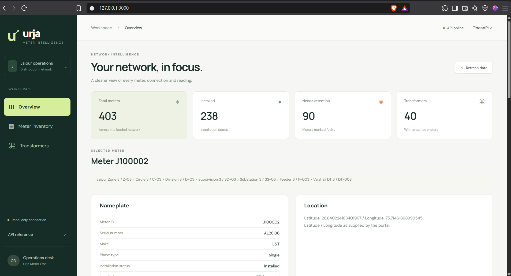

# Urja Meter API

A local, read-only API client and proxy service for the Urja Meter Ops portal, built for the Flock Energy engineering assignment. It allows external applications to query meter inventory, inspect nameplate and network hierarchy, retrieve historical readings, and look up transformer associations without handling portal authentication directly. A lightweight browser dashboard is included to inspect and visualize the same dataset.

The backend logs in on demand, manages session cookies in memory, extracts inventory metadata through a signed bulk export, and normalizes portal responses into consistent JSON. It performs no write operations against upstream meter or transformer records.


## Getting Started

### Prerequisites

- Node.js 24 or later (as defined in `package.json`)
- npm

### Installation

Install dependencies from the project root:

```sh
npm ci
```

### Configuration

Create a `.env` file in the root directory (based on `.env.example`):

```sh
PORTAL_PASSWORD=your_assigned_password
PORTAL_EMAIL=operator@example.com  # Optional: defaults to built-in operator account
PORT=3000                          # Optional: default 3000
HOST=127.0.0.1                     # Optional: default 127.0.0.1
```

| Variable | Description |
| --- | --- |
| `PORTAL_PASSWORD` | Required. Access password for the upstream portal. |
| `PORTAL_EMAIL` | Optional. Overrides the built-in operator account email. |
| `PORT` | Optional. Local listen port (default: `3000`). |
| `HOST` | Optional. Network interface bind address (default: `127.0.0.1`). |

> Keep credentials in `.env`. Do not commit credentials, cookies, signing keys, or raw authenticated HTTP traces. The repository `.gitignore` excludes local environment files while tracking `.env.example`.

Upstream base URLs and the 15-second per-request HTTP timeout are configured in `src/index.js`. Because operations such as login, key derivation, and token renewal may require multiple HTTP calls, this timeout applies per individual upstream request rather than as an end-to-end route deadline. Upstream proxy settings depend on the host runtime and are not managed by the application.

### Running the Service

Start the production server:

```sh
npm start
```

For development with Node's native watch mode:

```sh
npm run dev
```

No build step or external database is required.

### Endpoints and Interfaces

Once started, the following interfaces are available:

- **Dashboard:** [http://127.0.0.1:3000/docs/](http://127.0.0.1:3000/docs/) (also served at `/`)
- **Swagger UI:** [http://127.0.0.1:3000/api-docs/](http://127.0.0.1:3000/api-docs/)
- **OpenAPI Schema:** [http://127.0.0.1:3000/openapi.json](http://127.0.0.1:3000/openapi.json)

## API Reference

### Routes

| Method & Route | Description |
| --- | --- |
| `GET /health` | Process liveness probe: returns `{"status":"ok"}`. Does not query the upstream portal. |
| `GET /meters?q={search}&page={page}&limit={limit}` | Case-insensitive partial search by meter ID or serial, with pagination. |
| `GET /meters/{id}` | Meter details: nameplate specifications, transformer assignment, network hierarchy, and coordinates. |
| `GET /meters/{id}/readings` | Time-series readings (kWh, kVAh, and R-phase voltage) over the portal's default history window. |
| `GET /transformers/{id}/meters?page={page}&limit={limit}` | Paginated list of meters mapped to a specific transformer code. |

### Example Queries

```sh
# Search meters by partial ID or serial number
curl "http://127.0.0.1:3000/meters?q=SE33962&page=1&limit=20"

# Fetch a single meter's profile
curl "http://127.0.0.1:3000/meters/J100000"

# Fetch historical readings for a meter
curl "http://127.0.0.1:3000/meters/J100000/readings"

# List meters connected to a specific transformer
curl "http://127.0.0.1:3000/transformers/DT-007/meters"
```

*(Note: On Windows PowerShell, invoke `curl.exe` instead of the `curl` alias).*

### Data and Pagination Conventions

- **List Endpoints:** Paginated responses return an object with `data`, `total`, `page`, and `limit`.
  - Defaults: `page=1`, `limit=20`.
  - Maximum limit: `100`.
  - An empty search match returns an empty `data` list (`[]`).
  - An unknown meter or transformer returns `404 Not Found`.
  - A confirmed transformer with no associated meters returns an empty `data` list with `total: 0`.
- **Readings Endpoints:** Returns `meter_id` alongside a `data` array.
  - Missing numeric measurements are parsed as `null`.
  - Energy readings reflect raw cumulative register readings as reported by the hardware, not calculated interval delta consumption.
  - Timestamps preserve original upstream portal strings because the source timezone is unverified.

### Error Handling

All error responses share a standard JSON payload:

```json
{
  "error": {
    "code": "PORTAL_TIMEOUT",
    "message": "The portal request timed out."
  }
}
```

HTTP status codes map to specific failure modes:
- `400 Bad Request`: Query parameter validation failure.
- `404 Not Found`: Requested meter or transformer does not exist.
- `500 Internal Server Error`: Unhandled application exception.
- `502 Bad Gateway`: Upstream portal authentication failure, payload format error, connection drop, or portal server error.
- `503 Service Unavailable`: Upstream portal rate limiting.
- `504 Gateway Timeout`: Upstream request exceeded the 15-second deadline.

Raw Axios exceptions are intercepted and sanitized before returning to callers to prevent exposing internal session cookies or upstream tokens. Complete schemas are defined in [openapi.json](openapi.json).

## Dashboard

The browser interface is built with standard HTML5, CSS, vanilla JavaScript, and inline SVG, without requiring a build step or external UI framework.

- **Client-Side Filtering:** The dashboard fetches the complete normalized inventory on initial load. Search (by meter ID or serial), status filters, and transformer code filters run in-memory against this dataset.
- **Summary Cards & Exports:** Fleet metric cards reflect the full loaded inventory. Active filters apply directly to both the displayed table and CSV exports. Transformer counts reflect distinct codes assigned to active meters (unassigned/empty transformers are not counted).
- **Profile & Time Series:** Clicking a meter ID displays its nameplate data, coordinates, and hierarchy directly from the loaded inventory. Historical readings are retrieved on demand, rendered in a scrollable table (timestamp, kWh, kVAh, V_R), and plotted on an SVG chart. Missing numerical values create broken line segments rather than false zero interpolations. The arrow control and "View meter details" button open a modal dialog containing a direct link to the JSON payload.
- **Request Lifecycle:** Selecting a different meter immediately cancels any in-flight readings request via `AbortController` and discards late responses. Readings views handle loading, empty, and error states; re-selecting the meter triggers a fresh request. Meter metadata remains accessible even if reading calls fail. (Browser-side cancellation drops local processing, though upstream HTTP requests may still run to completion).
- **Refresh Semantics:** The dashboard "Refresh" button re-queries the local API metadata cache (it does not bypass the backend's 60-second cache window). "Inventory time" indicates when the browser retrieved the data, not upstream portal generation time. If a refresh fails, the existing inventory remains rendered alongside an error notification. The header health indicator polls only local process liveness (`/health`).
- **Styling:** Includes responsive mobile layouts, system font fallbacks if Google Fonts cannot load, and `@media (prefers-reduced-motion)` support.

## Architecture and Design

### Directory Structure

```text
urja-api/
|-- src/                    Backend API and portal integration
|   |-- index.js            Express routes, dashboard hosting, Swagger, errors
|   |-- client.js           Portal login, cookies, Axios requests, export signing
|   |-- inventory.js        Validated metadata cache (60 seconds), shared fetches
|   `-- parser.js           Meter/readings normalization, optional HTML adapter
|-- public/                 Browser dashboard (no frontend build step)
|   |-- index.html          Inventory, nameplate, location, readings table, dialog
|   |-- dashboard.js        API calls, selection, filters, charts, CSV export
|   `-- dashboard.css       Dashboard styling and responsive layouts
|-- openapi.json            Public API contract (OpenAPI 3.0.3)
|-- README.md               Setup, architecture, API usage, decisions, limitations
|-- PROTOCOL.md             Portal endpoints, authentication, signing, data quirks
|-- REFLECTION.md           Assignment reflection answers
|-- package.json            Dependencies, runtime requirement, npm commands
|-- package-lock.json       Locked dependency versions
|-- .env.example            Configuration template without real credentials
|-- .env                    Private local configuration; ignored by Git
|-- .gitignore              Excludes local secrets and generated files
`-- node_modules/           Installed dependencies; generated and ignored by Git
```

### Request Flow

```text
Express application (src/index.js)
|-- Dashboard: / and /docs/
|   `-- public/ assets --> local JSON API requests
|-- API documentation: /api-docs/ and /openapi.json
|-- Health: /health --> process liveness, no portal call
`-- Data routes: /meters, /meters/:id, /meters/:id/readings,
    |           /transformers/:id/meters
    |-- inventory.js --> 60-second normalized metadata cache
    |   `-- Cache miss --> client.js --> authenticated signed portal export
    |                     `-- parser.js --> validated, normalized inventory
    |-- Readings --> client.js --> portal energy endpoint --> parser.js
    `-- Unmatched transformer code --> client.js --> portal transformer pages
```

Incoming requests hit `src/index.js`. Meter metadata queries route through the in-memory cache in `inventory.js`. On a cache miss, `client.js` authenticates with the portal, signs a bulk export request, and passes the payload to `parser.js` for validation and schema normalization before caching.

Readings requests first verify the meter exists in inventory, call the portal's energy history endpoint via `client.js`, and normalize the data via `parser.js`. The dashboard consumes these local endpoints; portal credentials and session cookies never leave the Node process.

### Module Responsibilities

| File | Primary Responsibility |
| --- | --- |
| `src/client.js` | Axios client management, cookie jar persistence, shared login flows, session renewal, signed export retrieval, and error sanitization. |
| `src/inventory.js` | In-memory cache (60s TTL), cache validation, and coalescing concurrent in-flight fetches. |
| `src/parser.js` | Data normalization for meter and reading models; optional Cheerio HTML adapter. |
| `src/index.js` | Express server setup, route handlers, pagination logic, dashboard static hosting, and OpenAPI / Swagger routes. |
| `public/index.html` | Dashboard layout, inline profile cards, readings table, and detail modal. |
| `public/dashboard.js` | Client-side inventory fetching, filtering, meter selection, SVG chart rendering, and CSV exports. |
| `public/dashboard.css` | CSS styling, grid layouts, and responsive breakpoints. |
| `test/session.test.js` | Test fixtures for portal authentication, failure states, network timeouts, and export renewal. |
| `test/inventory.test.js` | Unit tests for concurrency handling, cache expiration, malformed exports, and retry behavior. |
| `test/dashboard.test.js` | DOM tests for meter selection and stale response suppression. |

*Note on HTML parsing:* The primary data extraction pathway uses JSON. The Cheerio parser (`parseHtmlRows`) is retained as an optional fallback adapter; current routes do not depend on HTML scraping. While portal search utilities exist in `src/client.js`, public meter searches filter the normalized in-memory export directly.

## Design Decisions and Assumptions

- **Bulk Export Invariant:** The portal export returns the complete meter population in a single payload. Before the cache accepts an export, the returned total must match the record count, records must pass schema validation, and meter IDs must be unique.
- **Separation of Metadata and Telemetry:** Metadata is normalized into a shared representation across meter models. Reading histories are retrieved on demand per meter rather than eagerly bulk-loading time-series data for the entire fleet.
- **Transformer Mapping:** Transformer associations require exact code matches. Regional hierarchy names and aliases are preserved as reported; empty or whitespace-only values normalize to `null`.
- **Telemetry Fidelity:** Upstream timestamps and cumulative energy counters are preserved verbatim without heuristic timezone adjustment, consumption derivation, or reset detection.
- **Process-Local State:** Cookie jars and cache entries are maintained in memory. Concurrent login calls share a single promise to prevent duplicate upstream handshakes. Standard GET requests retry once on session expiration. Rejected export signatures trigger fresh key generation and a single retry.
- **Network Scope:** Binds to `127.0.0.1` by default for local execution. The API does not implement client authentication; production network deployment would require an external gateway or authentication middleware.

## Caching and Concurrency

- **Metadata Cache (60s TTL):** Normalized inventory is cached in memory for 60 seconds following a successful fetch.
- **Request Coalescing:** Multiple concurrent requests during a cache miss share a single in-flight export call to prevent portal load spikes.
- **No Negative Caching:** Upstream fetch or validation failures are not cached.
- **Fail-Fast on Expiry:** If a refresh attempt fails after cache expiration, the service returns an error immediately rather than serving stale data. There is no automated background poll or manual cache-purge route.
- **Readings Bypass Cache:** Telemetry readings are fetched directly on each user request to reflect current portal data.

This strategy prevents redundant bulk exports during frequent UI navigation and pagination, trading off up to 60 seconds of metadata latency.

## Limitations and Future Considerations

### Current Non-Goals

- **External Persistence & Distributed Caching:** Unnecessary for single-instance local execution with the current inventory size.
- **Telemetry Transformations:** Configurable date ranges, computed interval delta consumption, register turnover detection, geospatial queries, and network topology graphs were omitted pending specific operational requirements.
- **Public Ingress Security:** Transport-level authentication, rate limiting for downstream consumers, and deployment manifests are outside the scope of this local assignment.

### Production Roadmap

- **Testing Coverage:** Add end-to-end HTTP integration tests and automated browser interaction tests (selection, pagination, search, responsive breakpoints).
- **Protocol Verification:** Further inspect session idle timeouts, signing key rotation policies, portal rate limits, and valid reading query ranges.
- **Schema Validation:** Implement automated runtime validation of parsed fields against `openapi.json` schemas.
- **Distributed Scaling:** For multi-instance deployments:
  - Move metadata caching to Redis with a 60-second TTL.
  - Implement distributed locks (e.g., Redlock) to coalesce concurrent cache misses across instances without duplicate exports.
  - Define explicit fallback behavior for Redis connectivity failures.
- **Large Dataset Handling:** If inventory expands beyond what fits comfortably in memory, transition from full-table scanning to a persistent indexed datastore with database-level pagination and filtering, and update the frontend to fetch paginated subsets on demand.

## Supporting Documentation

- [PROTOCOL.md](PROTOCOL.md): Details upstream portal authentication flows, undocumented endpoints, signing mechanisms, data normalization rules, and observed quirks.
- [REFLECTION.md](REFLECTION.md): Engineering reflection responses regarding design tradeoffs and implementation choices.
- [openapi.json](openapi.json): Full OpenAPI 3.0.3 specification covering endpoints, request parameters, and response schemas.